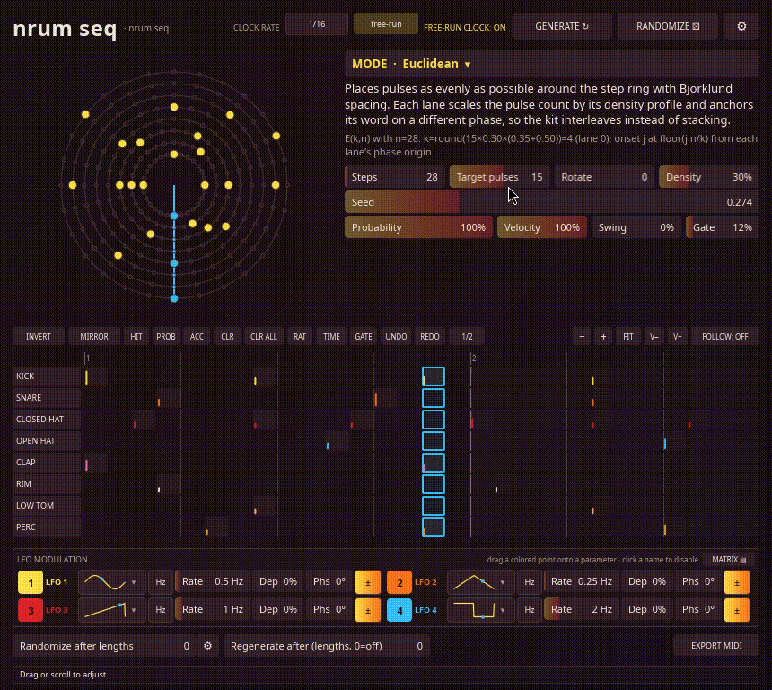

# nrum seq

**Algorithmic percussion MIDI sequencer (CLAP + VST3), written in Rust.**



So... first of all, yes its partially less and partially heavier created with LLM assistance.

nrum seq is the percussive sibling of [nelody seq](https://github.com/ccne4mocc): the same
architecture and editor layout, but with an eight-lane GM drum matrix instead of a right-to-left
piano roll. It generates **MIDI note events, not audio**, over MIDI channel 10. Place it before a
drum sampler or drum rack on an instrument track and use the plug-in as a generative drummer.

This plugin grew out of lot of interessents in the last years, especially by starting to teach myself piano play and getting my head stuck in endless rabbit holes in music production & electronic music (and birds... and sound design... and music theory and so on lol). I was kinda unsatisfied with sequencers and generative stuff, also some where really unstable (looking at you HY-RPE), on the other side a variaty of plugins/software like strudl, supercollider and some other euclidian sequencers were awesome and really hooked me.

I wanted something inbetween that allowed me to play around and jam fast with concepts & ideas, polymeter creation and something  usable for funny / experimental piano instrument play but also technical production.
One reason was also knowing talented drummers that turn off their heads when complicated words come... so I needed some tool that can bridge the ideas I want to commuinicate (you know... for when it gets esoteric with ideas) - but well who knows ... drummers^^

The basis for this project were lot of other side projects/works and linux music projects, which brought me to the point to use my former IT experience to get back a bit into coding and use opencode to concretize, build and merge my sideproject mess & ideas into these 2 plugins. Cause I didn't plan to come so far from 5 smaller Projects and also uncertain to even publish, I messed up to have a cleaner longer history but whatever...

Everything is deterministic and bounded for a given parameter snapshot and seed, so a pattern can
be recalled, automated and exported without hidden state.

The plugin still needs polish in many directions and I'm also planning to add more modes from time to time and partially slim it down. Some functionalities are rather rudimentary like internal lfos, since DAW LFO tools can be linked to the plugin parameters. Sequencer Matrix is also rather simple, cause I often record the midi or sound input directly into clips or just use the export midi function.
Also it can get visually confusing with higher parameter values and some combinations, depending on modes. Nevertheless, having the limits loose was more fun (step ceiling can be increased in settings). Optimizing and giving more depth in the view/presentation is also somewhere on the list (first 1D/2D more work, but also 3D ideas). 
It's quite possible that I will smack both plugins to 1 package but I'll see. 

Be also aware, switching theme to "Sketch" might burn your retina if you live in a cave like me.
A reaper jsfx version is also on the way, but I'm not really fond of it right now.

The windows variants are experimental, my focus is mainly on linux but they worked with my tests.

Enjoy :3

## Highlights

- **8 drum lanes** on MIDI channel 10, with GM-style defaults for kick, snare, hats, clap, rim,
  low tom and percussion. Each lane has its own note, velocity, density, phase and enable.
- **40 generators** across rhythmic, stochastic, physical, chaotic and formal families.
- **Fixed 1–1024 step grid**, with a configurable ceiling (64–1024, default 256).
- **Real-time safe audio path**: no allocation, locking, file I/O or unbounded loops inside
  `Plugin::process()`.
- **Per-step editor** with hit overrides, probability, accent, ratchets, microtiming and
  per-cell gate length, plus undo/redo and a matrix ruler.
- **Four runtime LFOs** that can be dragged onto numeric parameters and persisted with the
  project.
- **Mode-aware Randomize** and per-length randomization with a scope mask.
- **One-loop MIDI export** to a timestamped Standard MIDI File.
- **Four themes** and built-in starting-point presets.

## Quick start

1. Build the plug-in (see [Build](#build)).
2. Place the resulting CLAP or VST3 before a drum sampler on an instrument track.
3. Pick a mode, set the length and pulse count, then hit Generate.
4. Route the plug-in's MIDI output to the sampler.

nrum seq is a MIDI effect. If it is placed on a bus or on a track without an instrument
downstream, it will generate events but nothing will make a sound.

## Pattern editing

The step matrix is also an editor. Each cell can override the generator's hit, probability,
accent, ratchet count and gate length. Step-wide microtiming shifts the feel without moving the
grid, and edits are applied in display space so they survive Rotate, Mirror and Generate.

Navigation supports horizontal and vertical zoom, `FIT`, native scrollbars, wheel-to-scroll and
Alt+wheel horizontal panning. A lane-label column follows the vertical scroll, and follow mode
keeps the playhead centred while the transport runs.

Hover descriptions and edit/export feedback appear in a thin status strip at the bottom, away
from the pointer.

## Modulation and randomization

Four LFOs sit in a 2×2 rack below the matrix. Each has a waveform, Hz or beat-synced speed,
depth (0–200%), phase, polarity and an enable toggle. Drag an LFO point onto any numeric
parameter to create a link; linked controls show a depth band and a second animated value bar.
The modulation matrix lists every link and removes them with a per-row ×.

Randomize draws from mode-aware palettes instead of uniform noise, so lengths, pulse counts,
density, probability and velocity land on musically useful values. The scope mask can restrict
randomization to Mode, Length, Rhythm, Tone or Feel.

## Modes

The 40 generators use the same category taxonomy as nelody seq, which adds the Acid group. The
full mapping, derivation and view geometry live in
[`docs/REFERENCE_MAPPING.md`](docs/REFERENCE_MAPPING.md) and
[`docs/MODE_EXAMPLES.md`](docs/MODE_EXAMPLES.md).

| Category | Modes | Count |
|---|---|---:|
| Rhythm | Euclidean · Oscillator / Phase · Raised-Cos Threshold · Slowcat Rhythm · Toussaint Distance · Well-Formed Rhythm · L-System Grammar · Phase Shift / Reich · Polyrhythm Stack · Weighted Syncopation · Euclidean-Swing Hybrid | 11 |
| Stochastic | Markov Walk · Probabilistic (Bernoulli) · Genetic Mutation · Brownian Walk · Levy Flight | 5 |
| Chaos / Physics | Logistic Map · Pebble Box · Kuramoto Lanes · Reaction-Diffusion · Lorenz Attractor · Arnold Circle Map · Tent Map · Henon Map | 8 |
| Fractal | Cantor Set Rhythm | 1 |
| Cellular | Cellular Automaton · Life-like CA | 2 |
| Geometric | Eulerian Walk · Golden Ratio / Phyllotaxis · Crystallographic · Hilbert Curve · Ulam Spiral Primes | 5 |
| Number Theory | Xenakis Sieve · Fibonacci/Sturmian · Sturmian Word · Vuza Canon · Thue-Morse · Rudin-Shapiro | 6 |
| Music Theory | African Bell Patterns · Polymetric Phase Canon | 2 |
| **Total** | | **40** |

## Build

Requirements: Rust 1.88 or newer, a C/C++ build toolchain, and the usual Slint windowing
dependencies on Linux.

```sh
cargo check --lib
cargo test --lib
cargo xtask bundle nrum-seq --release
```

The bundle command writes CLAP and VST3 builds under `target/bundled/`.

The `nice-plug` dependency is pinned to a commit in the
[`ccne4mocc/nice-plug`](https://github.com/ccne4mocc/nice-plug) fork. It carries state-loading
and Carla activation fixes that the crates.io `0.4.x` line does not. See
[`docs/MIGRATION_nice-plug.md`](docs/MIGRATION_nice-plug.md) for the details.

### Windows

Cross-compiling from Linux with MinGW is the verified path:

```sh
rustup target add x86_64-pc-windows-gnu
cargo check --target x86_64-pc-windows-gnu
cargo xtask bundle nrum-seq --release --target x86_64-pc-windows-gnu
```

MSVC targets are also configured:

```sh
rustup target add x86_64-pc-windows-msvc
cargo xtask bundle nrum-seq --release --target x86_64-pc-windows-msvc
```

MSVC builds are not verified on a real Windows system. The `Bundles` workflow builds Linux and
Windows artifacts on `v*` tags and can also be dispatched manually from GitHub Actions.

## Compatibility

Version 1.3.1 uses the host identity `com.nrumseq.nrumseq` (CLAP) and `nrum-seq` (VST3 class ID).
Sessions created with the old `com.ndrum.ndrum` / `nDrum` IDs must replace the plug-in instance.

## Status and limitations

- Not release-certified. Host smoke-testing is still required for each DAW.
- `clap-validator` passes 33 tests with 11 skipped and 0 failures on the pinned `nice-plug`
  fork; host-side state round-trips still need manual verification.
- Windows/MinGW builds scan, load and process under Wine/REAPER, but have not been run on real
  Windows. REAPER's bridged VST3 editor path is a known failure mode; run unbridged.
- macOS is not configured.
- Fixed UI size (860×768), with no separate scaling preference.
- MIDI export writes one loop and uses the plug-in process working directory, not the DAW
  project path.
- Microtiming is step-wide and only positive delays are scheduled. Ratchets are capped at four.

## Project layout

```text
src/
  lib.rs              parameters, transport scheduler, CLAP/VST3 exports
  modes.rs            generator list, display order and host metadata
  editor.rs           Slint adapter and host parameter callbacks
  globals.rs          shared state and user-global settings
  help.rs             mode descriptions and formulas
  modulation.rs       LFO clocks, signals and link masks
  randomize.rs        mode-aware randomization vocabularies
  midi_export.rs      Standard MIDI File writer
  view.rs             pure geometry for every panel
  sequence/           one generator per file, each with unit tests
ui/app.slint          Slint widgets, layout and mode picker
docs/                 architecture, reference mapping, verification and research notes
xtask/                bundle and assembly runner
vendor/               vendored Slint/baseview adapter
```

## Documentation

| Document | Contents |
|---|---|
| [`docs/README.md`](docs/README.md) | Documentation index |
| [`docs/ARCHITECTURE.md`](docs/ARCHITECTURE.md) | Layers, invariants and data flow |
| [`docs/REFERENCE_MAPPING.md`](docs/REFERENCE_MAPPING.md) | Where every mode and view came from |
| [`docs/MODE_EXAMPLES.md`](docs/MODE_EXAMPLES.md) | A starting point for every mode |
| [`docs/LFO_SYSTEM.md`](docs/LFO_SYSTEM.md) | LFO clocks, targets, links and persistence |
| [`docs/EDIT_OVERLAY.md`](docs/EDIT_OVERLAY.md) | Per-step edit overlay semantics |
| [`docs/HOST_VERIFICATION.md`](docs/HOST_VERIFICATION.md) | What has actually been tested |
| [`docs/RELEASE_CHECKLIST.md`](docs/RELEASE_CHECKLIST.md) | Release and host smoke-test checklist |
| [`docs/ALGORITHM_RESEARCH.md`](docs/ALGORITHM_RESEARCH.md) | Algorithm sources and citations |
| [`docs/CHANGELOG.md`](docs/CHANGELOG.md) | Release notes |

## Credits and license

- Author: `ccne4mocc / feN`
- Copyright (C) 2026 ccne4mocc / feN
- License: **GPL-3.0-or-later** (see [LICENSE](LICENSE)).

## Support

<a href="https://buymeacoffee.com/awpe6kbwk9">
  
</a>
